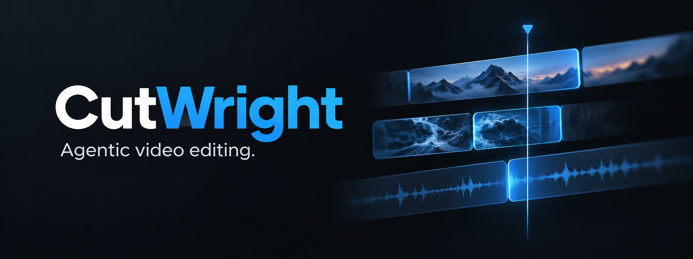

<p align="center">
  <a href="https://app.cutwright.cc"></a>
  <a href="https://github.com/iwatkot/cutwright/releases/latest"></a>
  <a href="#docker"></a>
</p>

<p align="center">
  <a href="https://cutwright.cc"></a>
</p>

<p align="center">
  <a href="#overview">Overview</a> ·
  <a href="#how-to-launch">How to launch</a> ·
  <a href="https://cutwright.cc/docs/">User guide</a> ·
  <a href="#agent-connections">Agent connections</a> ·
  <a href="#development">Development</a> ·
  <a href="https://buymeacoffee.com/iwatkot">Donate</a>
</p>

<p align="center">
  <a href="https://github.com/iwatkot/cutwright/releases/latest"></a>
  <a href="https://github.com/iwatkot/cutwright/actions/workflows/release.yml"></a>
  <a href="LICENSE"></a>
  <a href="https://hub.docker.com/r/iwatkot/cutwright"></a>
  <a href="https://github.com/iwatkot/cutwright/stargazers"></a>
</p>

## Overview

**CutWright is a free, open-source video editor for your browser and Windows, with optional agent control.** Edit by hand or connect a compatible agent to work on your live project. Editing and export run on your device. No account, media upload, render server, or subscription is required for the editor.

- **Build your edit:** multitrack video and audio, trimming, splitting, speed and picture adjustments.
- **Finish the frame:** titles, graphic elements, captions, transitions, and project sizing.
- **Stay precise:** timeline markers, snapping, rulers, guides, a grid, and preview zoom/pan.
- **Work your way:** configurable shortcuts, light/dark/automatic appearance, 11 interface languages, project save/open/recovery, and local MP4 export.
- **Bring your agent:** validated project edits, undo/redo, and export through local MCP on Windows or WebMCP in compatible browsers.

Start with the [first-video guide](https://cutwright.cc/docs/getting-started/), or browse the [complete manual](https://cutwright.cc/docs/).

Choose the globe in the editor's top bar or the website footer for **English, Deutsch, Dansk, Hrvatski, Srpski, Čeština, Nederlands, Français, Español, Русский, or Українська**. The entire user guide is available in each language. Your choice is remembered; switching languages preserves project content and undo history. Serbian uses Latin script.

## How to launch

| Option | What you need | Start here |
| --- | --- | --- |
| **Browser** | A current desktop browser | [Open CutWright](https://app.cutwright.cc) |
| **Windows** | Windows x64 | [Download the installer](https://github.com/iwatkot/cutwright/releases/latest) |
| **Docker** | Docker with Linux containers, x86-64 | [Run the browser editor locally](#docker) |
| **Source** | Git, Node.js 24 LTS, npm | [Start from source](#from-source) |

### Browser

Open **[app.cutwright.cc](https://app.cutwright.cc)**. Use a current desktop Chrome or Edge for the best-supported editing/export path; available media codecs depend on your browser and device.

Click **Import**, add your media, and start editing. **Save** downloads an editable project; **Export** creates the finished video. Keep your original media alongside saved projects. Browser storage belongs to the address you opened, so the hosted editor and localhost have separate local state.

### Windows

1. Open the [latest release](https://github.com/iwatkot/cutwright/releases/latest).
2. Download `CutWright-Setup-<version>.exe` and run the installer.
3. Launch **CutWright** from the Start menu or desktop shortcut.

Docker and Node.js are not needed. Releases also include `SHA256SUMS` and build manifests. The version appears beside the app logo.

### Docker

```sh
docker run -d --name cutwright -p 8080:80 iwatkot/cutwright:0.0.5
```

Open **[localhost:8080](http://localhost:8080)**. This image serves the browser editor; your browser still performs editing and export locally.

Stop and restart the same container:

```sh
docker stop cutwright
docker start cutwright
```

Use an exact [release tag](https://github.com/iwatkot/cutwright/releases) when choosing a version. Published tags have no `v` prefix. The image includes the headers and runtime notices needed by the browser build.

### From source

Install **Git** and **Node.js 24 LTS**, which includes npm. These commands check out the matching stable release:

```sh
git clone --branch 0.0.5 --depth 1 https://github.com/iwatkot/cutwright.git
cd cutwright
npm ci
npm run dev:web
```

Open **[localhost:5173](http://localhost:5173)**, or the local address printed in the terminal. Keep that terminal open; Ctrl+C stops the development server. To work on the newest development code instead, clone the default branch without `--branch 0.0.5`.

On Windows, start the desktop editor from the same checkout with:

```sh
npm run dev
```

## Agent connections

Click **Agent** at the bottom of the editor's left rail, then follow the connection instructions.

| Edition | Connection |
| --- | --- |
| **Windows app** | Enable local MCP and copy the displayed configuration into a compatible MCP client. Keep the editor open. |
| **Browser → Codex** | Install the small connector once using the command in **Agent → Codex → Setup instructions**, then connect the current tab. Requires Node.js 22+. |
| **Browser → Claude** | Install the downloadable CutWright `.mcpb` extension once, then choose **Agent → Claude → Connect**. Uses Claude's bundled Node runtime. |
| **Browser → WebMCP** | Enable WebMCP and use a compatible browser agent's chat. This option remains independent of the desktop connectors. |

Agent access is optional and starts disabled. The browser connectors run on your computer and pair with the tab you choose; no CutWright Windows editor or hosted relay is needed. Your browser may ask for local network permission. Keep the tab open and use your agent's own conversation. **Disconnect** revokes access; edits remain undoable. See the complete [connection and troubleshooting guide](https://cutwright.cc/docs/agents/).

## Development

### Persistent browser MCP from a CLI session

For a new machine, the repository can own the complete local browser editor and connect it autonomously through the visible Agent controls. It does not require desktop-agent tools or global client configuration. Clone this repository, use Node.js22+ and install the locked dependencies:

```sh
git clone https://github.com/iwatkot/cutwright.git
cd cutwright
npm ci
node node_modules/playwright-core/cli.js install chromium
npm run build:web
node scripts/browser-editor.mjs start --port=5173 --mcp-port=47903 --cdp-port=9224
node scripts/browser-agent-call.mjs --port=47903 tools
node scripts/browser-agent-call.mjs --port=47903 get_project
```

Use a task-specific browser cache on shared machines: set `PLAYWRIGHT_BROWSERS_PATH` to an absolute directory such as `<checkout>/.local/browsers` before the install and start commands. The owner records the resolved browser executable; its later scheduled launch does not depend on the caller's environment. `--executable=<absolute browser path>` can select an existing compatible Chromium executable. No browser-cache cleanup or system-font installation is required.

`browser-editor.mjs start` serves an immutable copy of the built browser files, starts the packaged stdio connector/CLI adapter, launches a persistent browser profile with native automatic downloads denied, pairs the intended tab through **Agent → Codex → Connect**, and verifies `get_project` and tool discovery. It never imports media, resets projects or starts an export. Windows ownership uses a separate on-demand Task Scheduler task under the current interactive user, with no recurring trigger or execution time limit; other systems use a detached owner. Health/status records actual process IDs, build/source identity, profile and endpoints in `.local/browser-editor/`. A stopped existing profile is copied before browser navigation to preserve media and abandoned export scratch.

Use `--state=<absolute directory>` to keep separate sessions and `--profile=<absolute directory>` to choose their durable profile. Change all three ports when another session owns the defaults. `start` reuses its own healthy session and refuses occupied ports or an uncertain live owner. The owner keeps an immutable build snapshot, so source/build changes cannot swap lazy modules under an active export. Save all project/video artifacts before stopping or switching builds. No export is restarted during recovery.

```sh
node scripts/browser-editor.mjs status
node scripts/browser-editor.mjs screenshot --output=<new.png>
node scripts/browser-editor.mjs stop
```

Pass the same `--state` to each command when using a non-default state directory. Screenshots attach with `noDefaults:true`. Stop verifies the owned profile and refuses while an export is running; it preserves that profile and all saved files. For updates: save through MCP, stop this owner, pull/build, start with the same state/profile/origin, reconnect, read the fresh revision and open the saved project through MCP. Keep original media. The bootstrap requires working local browser launch and, on Windows, permission to create the user's on-demand task; it reports a precise setup failure rather than changing unrelated services or asking for account logins.

Clip audio uses the existing `fadeIn`/`fadeOut` seconds and optional `fadeInCurve`/`fadeOutCurve` in -1..1 (zero is linear). Audio lengths retain the half-clip limit and split phase. Picture fades use separate `visualFadeIn`/`visualFadeOut` and `visualFadeInCurve`/`visualFadeOutCurve`, available through flat `setClipProps` fields, the Visual fades inspector and timeline handles. Picture fades work on video, images and editable titles; upper layers reveal lower layers and the base fades to black. A visual fade-out reaches zero on the last encoded clip frame. Fade every remaining visible ending layer, and end captions appropriately, when the final composition must be black. Native overlay source-animation fades remain independent.

`import_font` accepts an absolute local `path`, a title's `family` and optional integer `weight` (default400). It embeds original TTF/OTF/WOFF/WOFF2 bytes in the editable project: up to1MiB per font and four fonts per project. The title inspector's **Load font file** uses the same validated import. Preview and browser/native SVG rendering consume those embedded bytes; saved/opened projects retain them across machines without global installation. Font bytes are part of the project returned by `get_project`; retain private project files accordingly. Discover the current schema rather than assuming a fixed tool count.

Editable titles optionally accept `outlineWidth` (0..50 project pixels, default0/off) and `outlineColor` (`#RRGGBB` or `#RRGGBBAA`, default black) in their complete `addOverlay`/`setOverlay` content. The Text inspector exposes the same width and contextual color control. The shared preview/browser/native SVG renderer paints a rounded stroke behind the unchanged glyph fill, positions and roll. Use a restrained dark outline to retain light credits over light footage; it travels with saved projects/assets and scales with typography when resizing.

Transition IDs stay stable: `blur-inout` is now accurately named **Directional Smear** and retains the legacy `hblur` effect. **Camera Defocus** (`gaussian-defocus`, internal effect `gaussian`) is a separate, isotropic Gaussian focus-out/refocus crossfade. Generic `createTransition` blur requests choose camera defocus; explicit directional smear or `hblur` retains the earlier effect. Discover definitions with `get_project`, then use `applyTransition` with the desired `defId`. Preview, browser export and native export use the same focus-radius curve and frame placement. Fast text can still judder even when every frame is present: reduce travel per frame by allowing more rolling time before adding blur that may soften glyphs.

For an already-running agent session that cannot register new MCP servers, use the repository's local MCP SDK client. It forwards advertised tools to the same packaged stdio connector; it never edits project storage directly. Node.js 22+ and the source dependencies are required.

```powershell
npm run build:connectors
node scripts/browser-agent-session.mjs --port=47903
```

Keep that process running. Open your local browser editor, choose **Agent → Codex → Connect**, and keep the intended tab open. If several connectors appear, match its session code using the connection error from the first project query. No global account or agent configuration changes are required. In a second terminal:

```powershell
node scripts/browser-agent-call.mjs health
node scripts/browser-agent-call.mjs tools
node scripts/browser-agent-call.mjs get_project
node scripts/browser-agent-call.mjs apply_edits --file edit-arguments.json
```

Use the current `get_project.revision` as `expectedRevision` for every side effect. Discover the complete schemas with `tools`; a JSON arguments file avoids shell quoting issues. `import_media` accepts absolute local `paths`, probes original media in the browser and returns library IDs. `apply_edits` supports explicit track/clip creation and independently styled editable title layers, including pixel positions and rolling credits. `seek_preview` pauses and seeks the visible preview. Check decoded media readiness before taking screenshots.

`save_project` creates a validated editable project result. `export_video` starts the editor's real browser export; poll `get_export` until completed. Pass the returned `downloadUrl`, the latest `expectedRevision` and an absolute `.json` or `.mp4` `outputPath` to `save_download`. The paired connector writes those exact browser-produced bytes locally and refuses to overwrite existing files. Keep original media and the browser profile/origin; use `open_project` with an absolute saved project `path` to restore the editable project. Browser URLs last only while the tab and retained result remain available.

Export resolution and quality are independent. `export_video` accepts optional `quality: "high" | "balanced" | "compact"`; omitted quality remains `high`. The editor exposes these as **High**, **Balanced** and **Smaller file** in the compact **Export settings** popup beside Export. Quality changes video compression without changing project dimensions, frame rate, audio settings, edits or undo history. Browser job reports include the chosen quality and target video bitrate. Native jobs use CRF 18/23/28 respectively at every resolution; 480p no longer selects a separate CRF. Lower quality primarily reduces detail/file size and does not guarantee a faster render.

The adapter listens only on `127.0.0.1`, rejects browser-origin requests, and reports its own and connector process IDs via `health`. Use `--port=<port>` on both scripts for another session. Ctrl+C stops only this adapter and its connector. After rebuilding connector/tool schemas, POST `/reload-connector` on that adapter, reload the editor when its code changed, and reconnect through **Agent → Codex → Connect**. Read the project again; old revisions are invalid. Save first and preserve the editor URL/profile across reloads. If observing through Playwright CDP, attach with `{ noDefaults: true }` so the observer preserves the owner's download and browser settings.

For a headless browser owned by automation, use a persistent profile and `acceptDownloads: false` when all project/video artifacts will be saved through MCP. This denies the separate automatic native browser download; it does not revoke the app-generated blob returned by `save_project` or completed `get_export`. Use `save_download` to stream those exact bytes, then reopen the saved project or inspect the exported video. Keep the owner's download policy unchanged when attaching observers. This configuration also avoids a reproduced Chrome for Testing 153 native browser crash at automatic-download completion; enabling native downloads again reintroduces that path. A closed or crashed tab invalidates its blob URLs, so read the recovered project and request a fresh result before transferring it.

When the editor must outlive a CLI or desktop agent, launch the app server, persistent MCP session and browser owner independently of that agent's process tree. On Windows, separate on-demand Task Scheduler tasks under the current interactive user can provide that ownership; use no recurring trigger and no execution time limit. Record the task names, actual process IDs, profile path, origin and endpoints. Inspect existing tasks and ports before starting anything, and stop only the services belonging to that session. After a crash, preserve the stopped profile and inventory origin export scratch before navigating to the editor, because startup can reclaim abandoned export scratch. Never automatically restart an export during service recovery.

### Build

```sh
npm ci
npm run build:web
```

The static browser build is written to `dist/`. Serve the complete directory, including `third-party/`, over HTTPS with the headers in [deployment/nginx.conf](deployment/nginx.conf); localhost is supported for development. The included Docker image supplies this configuration.

On Windows, build an installer with:

```sh
npm run dist
```

Output: `release/CutWright-Setup-<version>.exe`. Use `npm run dist:dir` for an unpacked app. Keep the checked, version-specific postinstall codec corrections enabled when installing dependencies.

### Check changes

```sh
npm run typecheck
npm test
node scripts/audit-rc-widgets.mjs
npm run check:locales
```

After building, `node scripts/verify-runtime-notices.mjs` checks bundled dependency notices. The release pipeline also installs the Windows package and checks import, controls, local export, and full video/audio decode using generated fixtures.

The website hosts the complete user manual. Keep personal media, projects, credentials, internal prompts and build outputs out of commits.

Interface messages are in `src/i18n/messages/`. Keep every supported language complete when adding or changing visible text, accessible labels, help, or errors. `npm run locales:source` refreshes the English source list; locale checks reject missing messages and mismatched placeholders. Language is a viewing preference: preserve user-authored content and stable protocol identifiers.

### Release

Publish **one GitHub release in this repository**, using an unprefixed semantic version such as `0.0.3`. The release tag supplies the browser, Windows, and website versions.

1. The Linux job tests, publishes the Docker image, and deploys the browser editor.
2. The Windows runner builds and verifies the installed app, then attaches the installer, checksums, and manifests to that release.
3. After both succeed, the pipeline creates the same-tag release in the private website repository and deploys its matching version and verified download link.

Push website changes to its `main` branch before creating the app release. The deployed browser and website expose `/version.json`; app release manifests record the source commit and image/installer identity. Use a new tag for source changes after a release ships.

## License

CutWright is licensed under **[GNU AGPL-3.0](LICENSE)**. You may use, modify and redistribute it, including commercially. Covered redistributed versions must provide corresponding source under the same license; modified versions offered over a network must offer source to their users. Third-party dependencies retain their own licenses. Keep the bundled `third-party/` notices with redistributed browser and desktop builds. Earlier releases retain the license under which they were published.

Made by [iwatkot](https://github.com/iwatkot) · [Website](https://cutwright.cc) · [Buy me a coffee](https://buymeacoffee.com/iwatkot)
